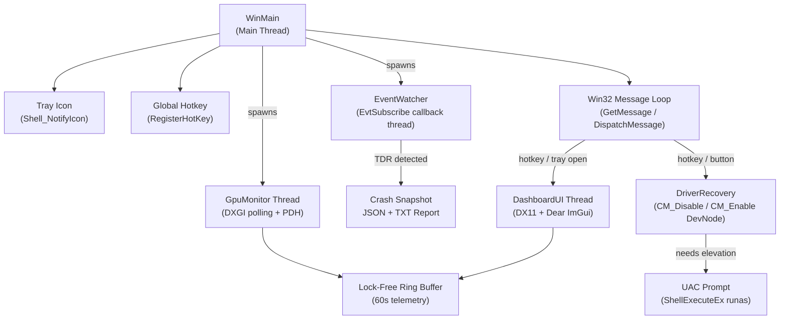

# TDRGuard 🛡️

**Lightweight GPU Watchdog, Crash Snapshotter & Instant Driver Recovery Tool for Windows**

[](LICENSE)
[](https://www.microsoft.com/windows)
[](https://en.cppreference.com/w/cpp/20)
[](https://github.com/ocornut/imgui)

---

## ✨ Features

- Runs silently in the **Windows System Tray** with a dynamic status icon (Green / Yellow / Red)
- **Global Hotkey** `Ctrl+Shift+Alt+R` for instant GPU driver recovery without reboot
- **Real-Time Telemetry**: VRAM usage, GPU engine load via DXGI + PDH, 60-second ring buffer
- **TDR Watchdog**: Monitors Windows Event Log for Event ID 4101 (Display driver recovery) and Event ID 161 (LiveKernelEvent)
- **Automated Crash Snapshots**: JSON + TXT reports exported to `%LocalAppData%\TDRGuard\Crashes\` right at freeze time
- **GPU Driver Reset**: Safe `CM_Disable_DevNode` / `CM_Enable_DevNode` reset via CfgMgr32
- **ImGui Dashboard**: On-demand live VRAM/GPU graphs, crash report list, settings

---

## 🏗 Architecture



| Thread / Component | Responsibility |
|---|---|
| **Main Thread** | `WinMain`, tray icon lifecycle, hotkey registration, Win32 message pump |
| **GpuMonitor Thread** | DXGI adapter polling, PDH GPU% counters, lock-free 60-second ring buffer |
| **EventWatcher** | `EvtSubscribe` callback for Event ID 4101 / 161, triggers crash reporter |
| **DashboardUI Thread** | DirectX 11 swap chain + Dear ImGui — only alive when dashboard is open |
| **DriverRecovery** | `CfgMgr32` display adapter soft-reset; self-elevates via UAC on demand |

---

## 📋 Requirements

| Requirement | Version |
|---|---|
| **OS** | Windows 10 or 11 (x64) |
| **Compiler** | MSVC 2022 (Visual Studio 2022 or Build Tools) |
| **CMake** | 3.25 or later |
| **Git** | Any recent version (used by CMake `FetchContent` to download Dear ImGui) |
| **Windows SDK** | 10.0.22000 or later |

> [!NOTE]
> Dear ImGui is the **only** external dependency and is fetched automatically at configure time via `FetchContent`. No manual submodule initialization or vcpkg required.

---

## 🔨 Building

### Option A — CMake (Recommended)

```bash
git clone https://github.com/yourusername/TDRGuard.git
cd TDRGuard
cmake -B build -G "Visual Studio 17 2022" -A x64 -DCMAKE_BUILD_TYPE=Release
cmake --build build --config Release
# Output: build/Release/TDRGuard.exe
```

### Option B — MSVC Developer Command Prompt

Open **"x64 Native Tools Command Prompt for VS 2022"**, then:

```bat
git clone https://github.com/yourusername/TDRGuard.git
cd TDRGuard
cmake -B build -G "NMake Makefiles" -DCMAKE_BUILD_TYPE=Release
cmake --build build
:: Output: build\TDRGuard.exe
```

> [!TIP]
> For a faster incremental build during development, use the `-j` flag: `cmake --build build --config Release -j 8`

---

## 🚀 Usage

| Action | Result |
|---|---|
| Double-click `TDRGuard.exe` | Launches silently into the system tray (no console window) |
| Left-double-click tray icon | Opens the live ImGui dashboard |
| Right-click tray icon | Context menu: Open Dashboard, View Crash Reports, Settings, Exit |
| `Ctrl+Shift+Alt+R` (global) | Emergency GPU driver recovery — works even during a frozen frame |

> [!IMPORTANT]
> GPU driver reset requires **Administrator** privileges. TDRGuard will prompt for UAC elevation on demand when you trigger a reset — it does **not** require you to run the application as Administrator at startup.

---

## 📂 Project Structure

```
TDRGuard/
├── CMakeLists.txt              # Build configuration (CMake 3.25+, FetchContent ImGui)
├── src/
│   ├── main.cpp                # WinMain, tray icon, hotkey, app lifecycle
│   ├── GpuMonitor.h/.cpp       # DXGI telemetry, PDH GPU%, lock-free ring buffer
│   ├── DriverRecovery.h/.cpp   # CfgMgr32 display adapter reset + UAC elevation
│   ├── EventWatcher.h/.cpp     # Windows Event Log subscription, crash reporter
│   ├── DashboardUI.h/.cpp      # DirectX 11 + Dear ImGui dashboard window
│   ├── resource.rc             # Version info, app manifest
│   └── TDRGuard.manifest       # UAC + DPI awareness manifest
└── assets/
    └── tdrguard.ico            # Application icon
```

---

## ⚙️ Configuration

All settings are configurable from the ImGui dashboard (no manual INI editing required):

| Setting | Default | Description |
|---|---|---|
| VRAM Alert Threshold | 90% | Tray icon turns yellow above this level |
| Start with Windows | Off | Writes / removes `HKCU\Software\Microsoft\Windows\CurrentVersion\Run` |
| Global Hotkey | `Ctrl+Shift+Alt+R` | Hotkey that triggers immediate GPU driver reset |

Settings are persisted automatically to `%LocalAppData%\TDRGuard\settings.json`.

---

## 🔒 Security & Permissions

- **Standard user** by default — no elevated install required
- GPU driver reset self-elevates via `ShellExecuteEx` with `runas` verb (UAC prompt shown to user)
- Windows Event Log reading for the System channel requires **no elevation** on modern Windows
- No network access, no telemetry, no data leaves the machine

> [!CAUTION]
> The GPU driver reset (`CM_Disable_DevNode` / `CM_Enable_DevNode`) briefly disables the display adapter. All open GPU contexts will be invalidated. Save your work before triggering a manual reset.

---

## 📊 Telemetry & Crash Reports

On TDR detection, TDRGuard immediately snapshots the last 60 seconds of telemetry from the ring buffer and writes two files to `%LocalAppData%\TDRGuard\Crashes\`:

- **`crash_<timestamp>.json`** — machine-readable structured report
- **`crash_<timestamp>.txt`** — human-readable summary

### Example JSON Report

```json
{
  "event": {
    "id": 4101,
    "time": "2024-01-15T22:34:17Z",
    "source": "System"
  },
  "adapter": "NVIDIA GeForce RTX 4090",
  "telemetry": [
    {
      "ts": "2024-01-15T22:33:17Z",
      "vram_used_mb": 9800,
      "vram_budget_mb": 24576,
      "vram_pct": 39.9,
      "gpu_pct": 98.5
    }
  ]
}
```

The dashboard's **Crash Reports** tab lets you browse, open, and delete these files directly without navigating to the folder.

---

## 🤝 Contributing

PRs are welcome! Please:

1. Follow the existing **C++20 / Win32** coding style
2. Test on both **Windows 10** and **Windows 11** before submitting
3. Use **Conventional Commits** for commit messages (`feat:`, `fix:`, `refactor:`, etc.)
4. Keep dependencies to zero — no new third-party libraries without prior discussion

---

## 📄 License

This project is licensed under the **MIT License** — see the [LICENSE](LICENSE) file for details.

---

*TDRGuard is not affiliated with Microsoft, NVIDIA, AMD, or Intel.*
